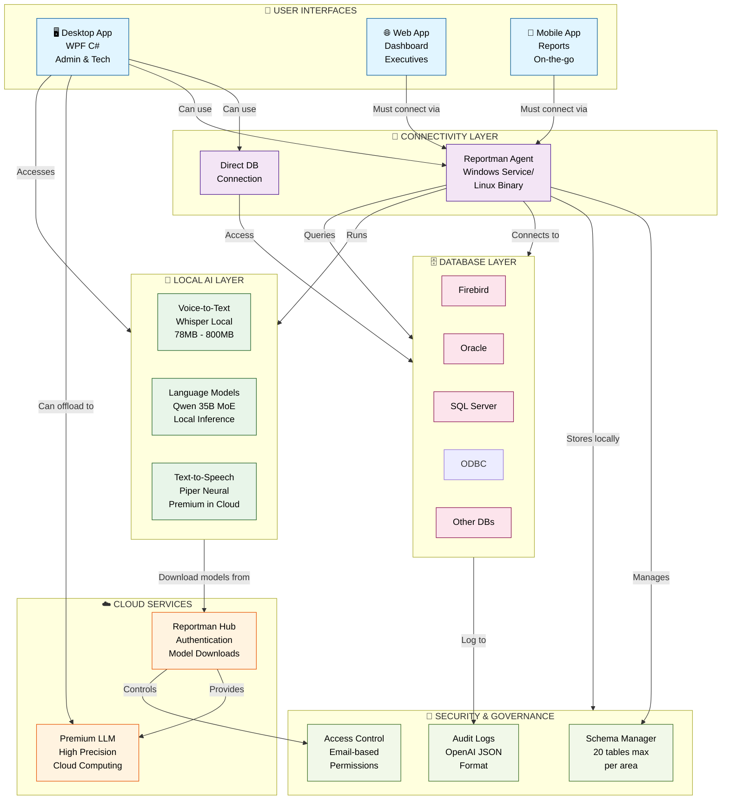

# Reportman AI - NLtoSQL Business Intelligence Platform

### Talk to your data — they'll return useful insights in seconds.

**Reportman AI** is a private-first Business Intelligence (BI) tool that transforms natural language into precise SQL queries for executives. Get KPIs, charts, and financial analysis in **seconds** (fast mode) without your data ever leaving your infrastructure.

**Core Capabilities:**
- ✅ **Query results** — accurate SQL generated from your natural language input
- 🔍 **Query audit** — full transparency on SQL execution
- 📊 **Charts & analytics** — automatic data visualization and AI-powered analysis
- 🗣️ **Voice input** — speak your questions naturally (STT + TTS)
- 🔒 **Data sovereignty** — your data never leaves your infrastructure
- ⚙️ **Local AI** — run models on-premises with GPU acceleration (NVIDIA CUDA, AMD Vulkan, CPU)

---

## 🏗️ Architecture Overview (Simplified)

```
┌─────────────────────────────────────────────────────────────────┐
│                    REPORTMAN AI ECOSYSTEM                       │
├─────────────────────────────────────────────────────────────────┤
│                                                                 │
│  Desktop App (WPF C#)      Reportman Agent        Web/Mobile    │
│  Admin & Technicians  ←→   (Linux/Windows)    ←→   Users        │
│  • Direct DB Connect       • Secure Bridge         • Dashboard  │
│  • Local AI Models         • Metadata Sync         • Reports    │
│  • GPU Management          • Computation Node      • Queries    │
│                                                                 │
│  All connected to: ☁️ Reportman Hub (Cloud) for auth & premium  │
│                                                                 │
└─────────────────────────────────────────────────────────────────┘
```

## 🔗 Detailed System Architecture



---

## 📦 Core Components

### Desktop Application (WPF C#)
- **Purpose:** Users talk to data to get insights
- **Features:**
  - Refine querys  
  - Query Audit
  - Automatic charts
  - Save Kpis
- **Purpose:** All-in-one tool for administrators and IT technicians
- **Features:**
  - Direct database connections (Firebird, Oracle, SQL Server, PostgreSQL, etc.)
  - Agent database connections
  - Create schemas from Agent databases or Direct databases
  - Local AI management with hardware detection (VRAM, CPU, GPU)
  - Support for GPU acceleration (NVIDIA CUDA, AMD Vulkan, CPU fallback)
  - Model download and inference execution
  - Schema validation using AI audit
  
### Reportman Agent (The Sentinel)
- **Deployment:** Windows Service or Linux native binary (/opt/reportman-agent/)
- **Purpose:** Secure bridge between local database and Web/Mobile users
- **Key Features:**
  - Database credentials stored locally (never synchronized to cloud)
  - Define the connections and developers by e-mail
  - Define the users that can access each schema by e-mail
  - Distributed computation node for LLM and voice transcription models
  - All Web and Mobile connections must flow through the Agent

### Intelligence & Multimodality Layer
- **Speech-to-Text (STT):** Whisper Local integration (78MB Base → 800MB Large Turbo)
- **Text-to-Speech (TTS):** Piper Neural local + Premium cloud voices with real-time word highlighting
- **Language Models (LLM):** MoE models (e.g., Qwen 35B) with complex reasoning for auditable SQL generation

### Data Management & Security
- **Schema Segmentation:** Organized by business areas to allow users to select the area and restrict users to certain areas (Accounting, Sales, Warehouse)
- **Schema Validation:** AI tool audits technical configuration before deployment
- **Access Control:** Email-based user management linked to specific schemas and AI models
- **Audit Logging:** OpenAI standard JSON format for technical supervision

### Connectivity Model
- **Desktop ↔ Database:** Direct connection OR via Agent
- **Desktop ↔ AI:** Local AI OR remote Agent AI
- **Web / Mobile ↔ Infrastructure:** MUST use Agent (security requirement)

---

## 💰 Pricing & Plans

### Plan Comparison

| Feature | **Free** | **Lite** | **Pro** | **Enterprise** |
|---------|----------|----------|---------|---|
| **Local Queries** | Unlimited✓ | Unlimited✓ | Unlimited✓ | Unlimited✓ |
| **Tables per Schema** | 5 | 50 | 150 | 300 |
| **Database Connections** | 2 | 5 | 20 | Unlimited |
| **Cloud LLM Queries** | - | Limited | High Volume | Custom |
| **Web/Mobile Access** | - | ✓ | ✓ | ✓ |
| **AI Models** | Local only | Local + Cloud | Local + Cloud | Local + Cloud |

### Pricing Strategy
- 🟢 **Free forever:** Unlimited local AI queries with no usage restrictions
- ☁️ **Cloud Tiers (Lite/Pro/Enterprise):** Monthly or annual subscriptions for cloud LLM access, web/mobile apps

---

## 🔒 Security Architecture

**Data Sovereignty Principles:**
- ✅ **Local-First:** All data remains on your infrastructure by default
- ✅ **GDPR/RGPD Compliant:** Database credentials never transmitted to cloud
- ✅ **Optional Cloud Processing:** Choose cloud LLM models only when needed
- ✅ **Full Transparency:** All SQL queries logged and auditable

**How Security Works:**
1. **Desktop App:** Connects directly to your database with local credentials
2. **Reportman Agent:** Acts as secure gateway, credentials stored locally only
3. **Web/Mobile:** Access restricted through Agent with granular permissions
4. **Audit Trail:** Every query logged in OpenAI standard JSON format for compliance

---

## � Technical Philosophy & Differentiation

### Why Reportman AI is Different

**1. Precision Over Guessing**
- We don't attempt auto-detection magic. Instead, we require technical teams to define semantic mappings between business concepts and database columns
- This eliminates hallucinations and ensures 100% query accuracy for critical business data
- Once mapped, the AI understands your exact business domain

**2. Zero Data Exfiltration**
- Your data never touches our servers unless you explicitly choose cloud features
- Our cloud servers never store your data (if you request data analysis)
- The cloud AI servers are private, never stores your querys or data. 
- All data retrieving happens locally on your infrastructure, our servers are just a bridge between web/mobile.
- Only metadata (schema definitions) is synced to the Hub with your explicit control

**3. Extreme Optimization**
- Fast mode: **less than 5 seconds** per query with MoE model reasoning
- Precision querys: **less than 15 to 50 seconds** depending on complexity
- GPU acceleration with NVIDIA CUDA, AMD Vulkan, or CPU fallback
- Designed specifically for enterprise financial analysis and KPI extraction

**4. Complete Transparency**
- Every SQL query is logged and auditable
- You can see exactly what AI generated 

### Supported Databases
Firebird, Oracle, SQL Server, PostgreSQL, MySQL, MariaDB, and others compatible with ODBC/JDBC

---

## �🚀 Installation Desktop

1. Download the latest desktop installer from the [Releases](https://github.com/tonimartir/ReportmanAIDesktop/releases) page.
2. Run the installer and follow the on-screen instructions.
3. Launch **Reportman AI** and connect to your database.

---

## �🚀 Installation Web

1. Download the latest agent installer from the [Releases](https://github.com/tonimartir/ReportmanAIDesktop/releases) page.
2. Run the installer and follow the on-screen instructions, in linux execute install.sh
3. Open localshot:9800 give a name to the Agent and connect to your database.
4. Add local AI engines(optional).
5. Add developers, mandatory so schemas can be created from web/desktop.
6. Create the first schema from web/desktop selecting the created agent.
7. Add user e-mails (optional), so users can ask but not modigy schemas
8. Test querys using the schema in web and mobile


---


## 🌐 Website

[https://ai.reportman.es](https://ai.reportman.es)

---

## 🌍 Supported Languages

The interface is available in: **English**, **Spanish**, **French**, **German**, **Italian**, **Portuguese**, **Chinese** and **Catalan**.

---

*© Reportman AI — Talk to your data.*
